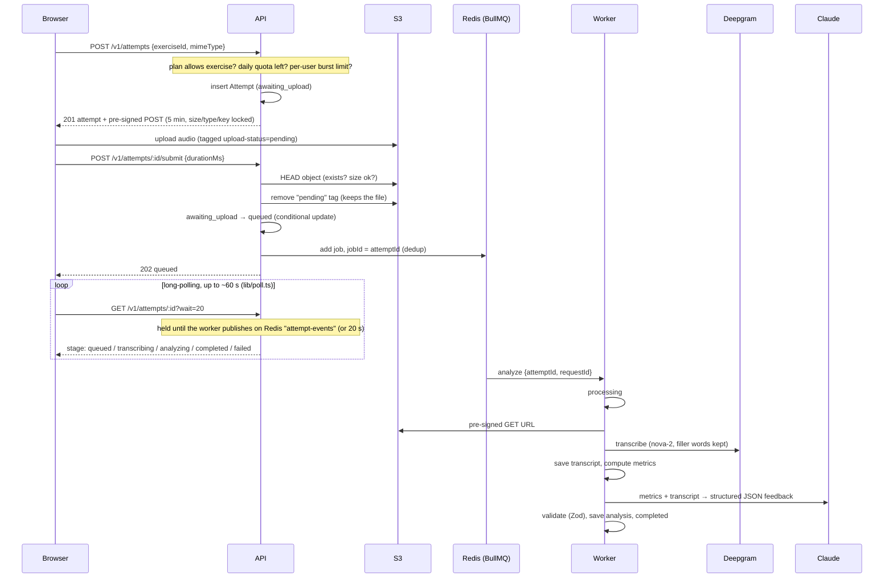
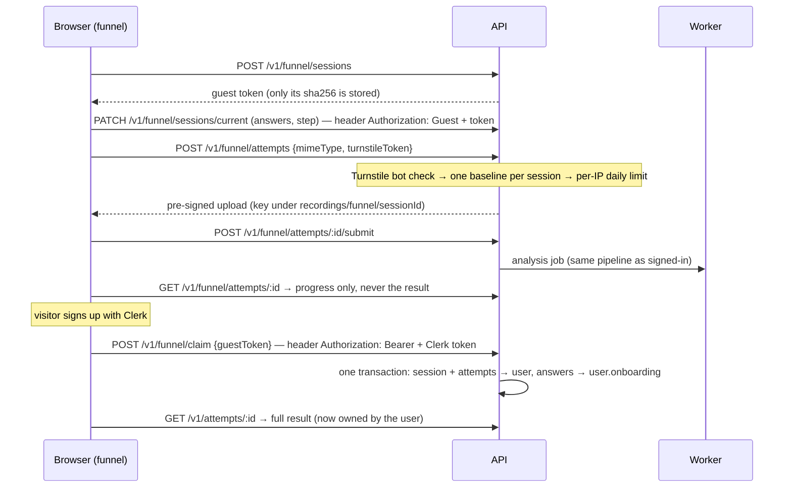
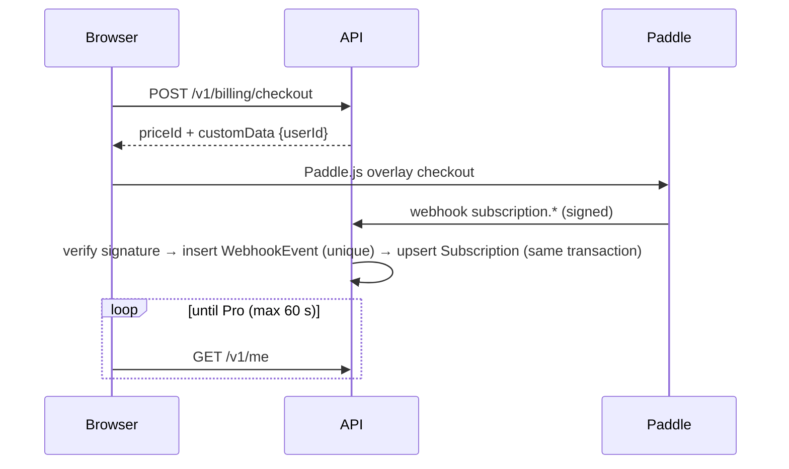
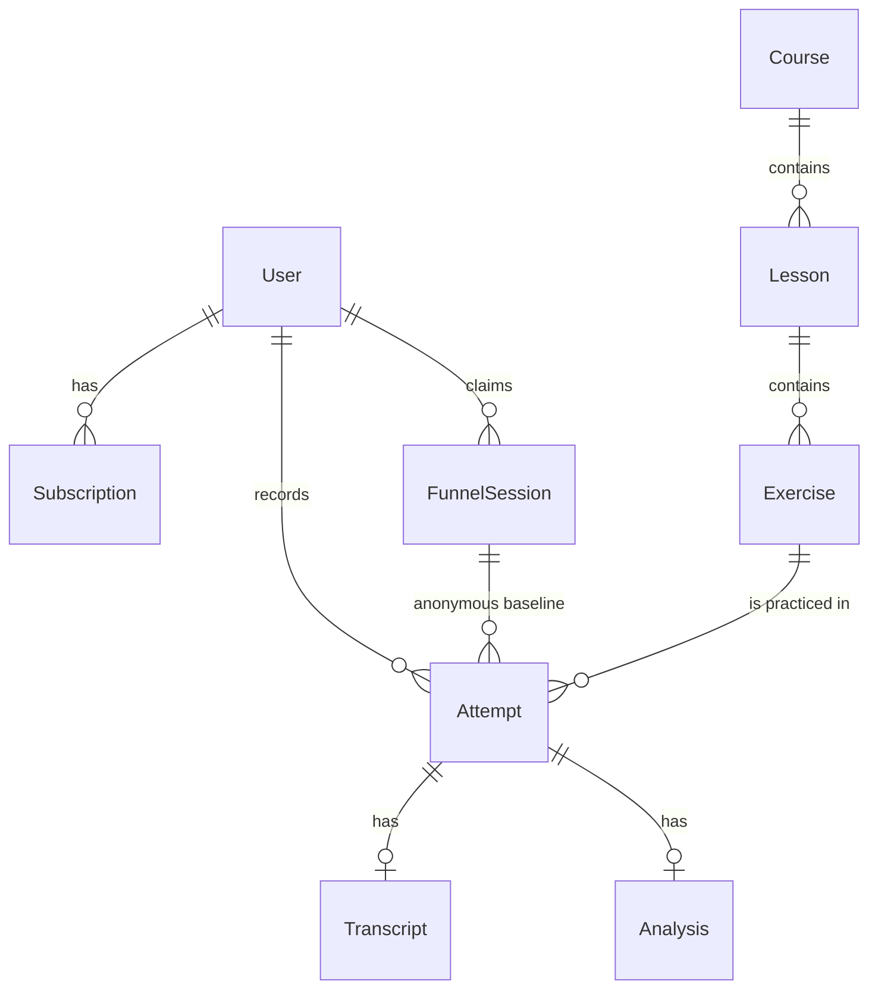

# Architecture

How SpeakUp is put together and how a request travels through it. For _why_ each piece was
chosen, see [`adr/`](./adr/README.md) and `SPEC.md` §14. For operating it, see [`runbook.md`](./runbook.md).

## System overview

| Part   | Code                                    | Job                                                                                                       |
| ------ | --------------------------------------- | --------------------------------------------------------------------------------------------------------- |
| Web    | [`apps/web`](../apps/web)               | Pages, the funnel, the recorder; talks only to the API (and to Clerk/Paddle/S3 directly from the browser) |
| API    | [`apps/api`](../apps/api)               | Auth, access rules, quotas, attempts, billing, webhooks. Stateless; scales 1–4 tasks                      |
| Worker | [`apps/worker`](../apps/worker)         | Slow work: speech-to-text, metrics, LLM feedback; daily cleanup                                           |
| Shared | [`packages/shared`](../packages/shared) | Zod schemas and constants used by web, API and worker (API contracts, queue payloads, analysis shapes)    |
| DB     | [`packages/db`](../packages/db)         | Prisma schema, migrations, seed, typed client                                                             |
| Infra  | [`infra/cdk`](../infra/cdk)             | AWS resources as code (one stack)                                                                         |

The repo is a pnpm + Turborepo monorepo: a change to a shared schema is seen by all three apps at
once, and `turbo` builds `shared` before anything that imports it.

## Two hosts, one web project

The web app is one Next.js project on Vercel with two domains attached:

| Host                       | Serves                                                           | Route group                |
| -------------------------- | ---------------------------------------------------------------- | -------------------------- |
| `speakup.fibipals.com`     | landing, `/privacy`, `/terms`, `/refund`                         | `apps/web/app/(marketing)` |
| `app.speakup.fibipals.com` | `/start`, `/sign-in`, `/sign-up`, `/app`, `/results`, `/pricing` | `apps/web/app/(product)`   |

- `proxy.ts` asks `routeForHost` (`apps/web/lib/hosts.ts`) on every request. A product route on
  the site host gets a **308** to the app host (path and query kept, so old links such as
  `speakup.fibipals.com/start?…` keep working); a legal page on the app host gets a 308 back.
  `/` on the app host is a **307** to `/app` (which sends signed-out visitors to sign-in).
- Every response on the app host carries `X-Robots-Tag: noindex`: only the marketing site is meant
  for search results.
- Links that cross hosts use `appHref()` / `siteHref()` (`apps/web/lib/links.ts`).
- The split is **off** unless both `NEXT_PUBLIC_SITE_URL` and `NEXT_PUBLIC_APP_URL` are set. Local
  dev and Vercel previews leave them empty and serve every page on one host.
- Clerk needs no satellite domain: `app.` is a subdomain of the Clerk instance's primary domain
  (`speakup.fibipals.com`, frontend API `clerk.speakup.fibipals.com`). Marketing pages show no
  session UI; sign-in lives on the app host only.
- Both origins are in `speakup:webOrigins` (`infra/cdk/cdk.json`), which feeds the API's CORS,
  Clerk's `authorizedParties` and the recordings bucket's CORS. The product only calls the API
  from the app host; the site origin stays listed so sessions open during the switch keep working.

## Network (AWS)

- **VPC** across 2 availability zones with public, app and data subnets and one NAT gateway.
- **Public subnets:** only the load balancer (HTTPS, certificate from ACM).
- **App subnets (private):** API and worker tasks, and the one-off migration task.
- **Data subnets (private, isolated):** Postgres and Redis; only the app security groups may connect.
- S3 is reached through a VPC gateway endpoint. Task roles may only touch `recordings/*`.
- Secrets reach containers as environment variables at task start (Secrets Manager), never in
  images, templates or git.

## Main flow: a recording becomes feedback

Design points:

- **Audio never passes through the API.** The browser uploads straight to S3 with a pre-signed
  POST whose policy fixes the key, the content type, the size range and the `pending` tag.
- **Never trust the client:** submit checks the file in S3 itself (metadata only).
- **Idempotent everywhere:** a repeated submit reports the current state; the job id equals the
  attempt id, so a job is queued at most once; the worker skips finished attempts and reuses a saved
  transcript on retry (no second speech-to-text bill).
- **Two status fields:** `status` (stored: `awaiting_upload → queued → processing → completed | failed`)
  and `stage` (derived for the UI: `processing` is reported as `transcribing` until the transcript
  exists, then `analyzing`).
- **Failures:** retryable errors (timeouts, 429/5xx) are retried by BullMQ 3× with exponential
  backoff; non-retryable ones (`NO_SPEECH`, invalid LLM output twice, 4xx) fail the attempt at once
  with an `errorCode` the UI turns into a message. Abandoned uploads expire after a day (S3 lifecycle).

## Funnel flow: anonymous recording, claimed at sign-up

The funnel (`/start/<step>`) lets a visitor record a baseline **before** creating an account.

- The guest token is a separate auth scheme (`Authorization: Guest …`), so it can never be mistaken
  for a Clerk session. Results are shown only after the claim, to the account owner.
- Funnel state also lives in the browser (`localStorage`), so a reload resumes the same step.
- Unclaimed sessions and their recordings are deleted after 7 days (worker, daily).

## Identity and access

- **Clerk** handles sign-up/sign-in. The web app sends the Clerk session token as a Bearer token;
  the API verifies it (only tokens minted for our own web origins are accepted).
- **Lazy provisioning:** the first authenticated request creates our `User` row (no Clerk webhook). Concurrent first requests are safe: the one whose insert loses on the unique `clerkUserId` reads the winner's row.
- **One place decides the plan:** `getEntitlements()` (`apps/api/src/services/entitlements.ts`).
  A user is Pro if any subscription is `active`/`trialing` and its period hasn't ended.
- **One rule for content:** `canAccessLesson()` — free lessons for everyone, the rest for Pro. The
  course list (to show locks) and the lesson/attempt endpoints (to enforce them) use the same function.
- **Ownership:** someone else's attempt returns the same 404 as a missing one, so ids can't be probed.

## Billing

- The browser's "payment succeeded" is never trusted: only the signed webhook changes the plan.
- **Idempotent:** `WebhookEvent(source, eventId)` is unique, so a re-delivered event is a no-op.
- **Out of order:** an event older than the subscription's `lastEventAt` is recorded but ignored.
- Paddle is the merchant of record (it handles taxes); `PaymentProvider` is an interface so another
  provider could be added.

## Data model

- `Attempt` belongs to a user **or** a funnel session — enforced by a database CHECK constraint
  (`Attempt_owner_check`) as well as in code.
- `Exercise.lessonId = null` marks the baseline exercise (used by the funnel and the dashboard).
- `Analysis` stores metrics and feedback as JSON validated by the shared Zod schemas, plus the model,
  prompt version, latency and estimated cost of each analysis.
- `WebhookEvent` exists only for webhook idempotency.
- Full schema: [`packages/db/prisma/schema.prisma`](../packages/db/prisma/schema.prisma).

## Analysis pipeline (worker)

1. **Speech-to-text** — Deepgram `nova-2` with `filler_words=true` and punctuation (newer models
   dropped "um/uh", which would hide filler words from users).
2. **Metrics** (pure functions, `apps/worker/src/metrics/`) — words per minute against a 130–160
   target, pauses (≥ 0.5 s; long ≥ 1.5 s), filler words ("um", "uh"… always; "like", "so",
   "basically", "actually", "you know" only in filler positions), low-confidence words, and for
   read-aloud exercises reading accuracy (missed / changed / extra words).
3. **Guard** — fewer than 5 real words → `NO_SPEECH`, no LLM call.
4. **Feedback** — Claude with structured JSON output (score, summary, strengths, up to 4 issues with
   evidence and a tip, next step), validated with Zod; one repair round if validation fails.
5. **Save** — analysis + cost estimate; the attempt becomes `completed`.

## Security measures (summary)

- Validation with Zod at every boundary: env vars at boot, HTTP bodies/params, queue payloads,
  webhooks, LLM output.
- Rate limits: global per-IP (300/min, Redis-backed so it holds across tasks), per-user attempt burst
  (10/min), per-IP funnel analyses (3/day, IP stored only as a salted hash).
- Bot check (Cloudflare Turnstile) before any anonymous analysis.
- Private recordings bucket, encryption at rest, TLS-only; pre-signed URLs expire in minutes.
- Logs redact tokens, emails, transcripts and audio URLs.
- Security headers (helmet), CORS allowlist, 100 KB body limit.
