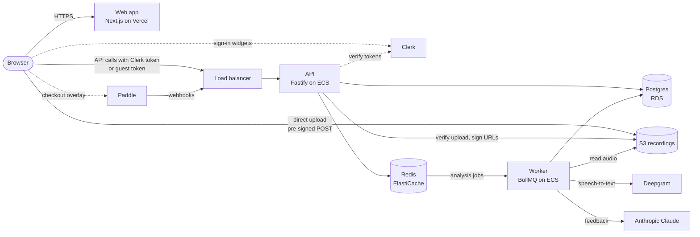
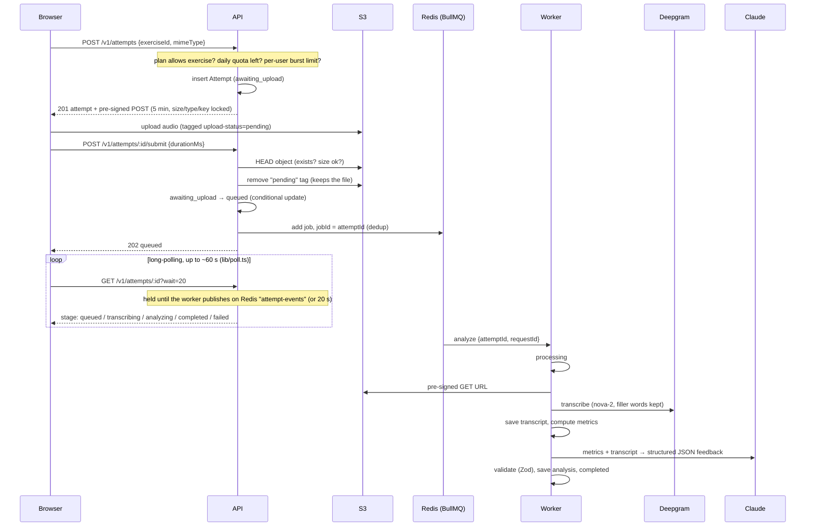
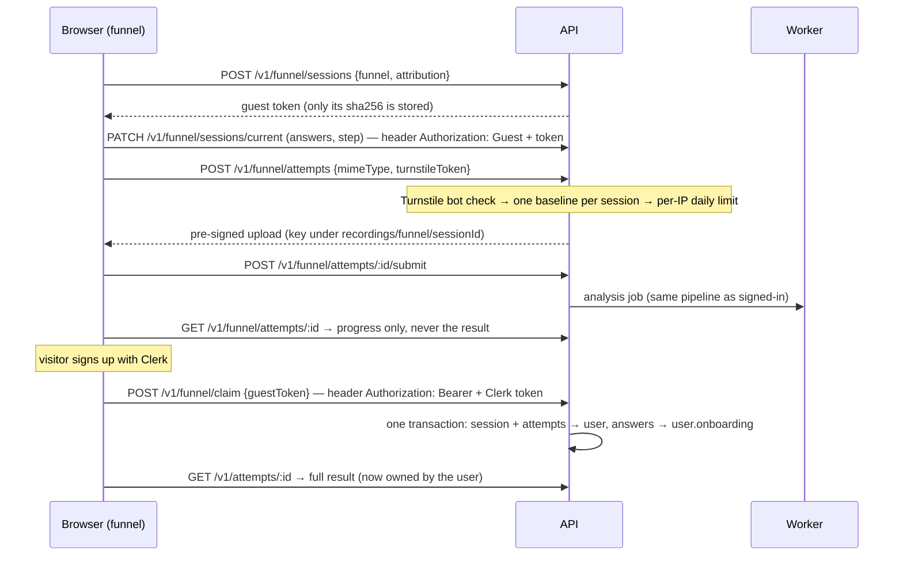
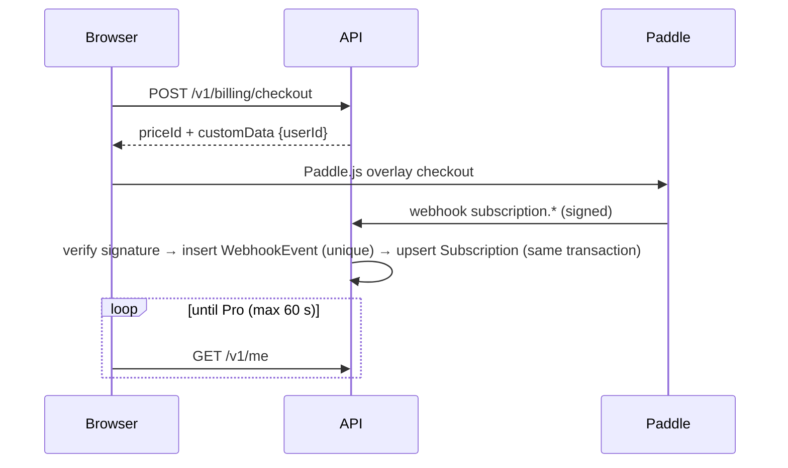
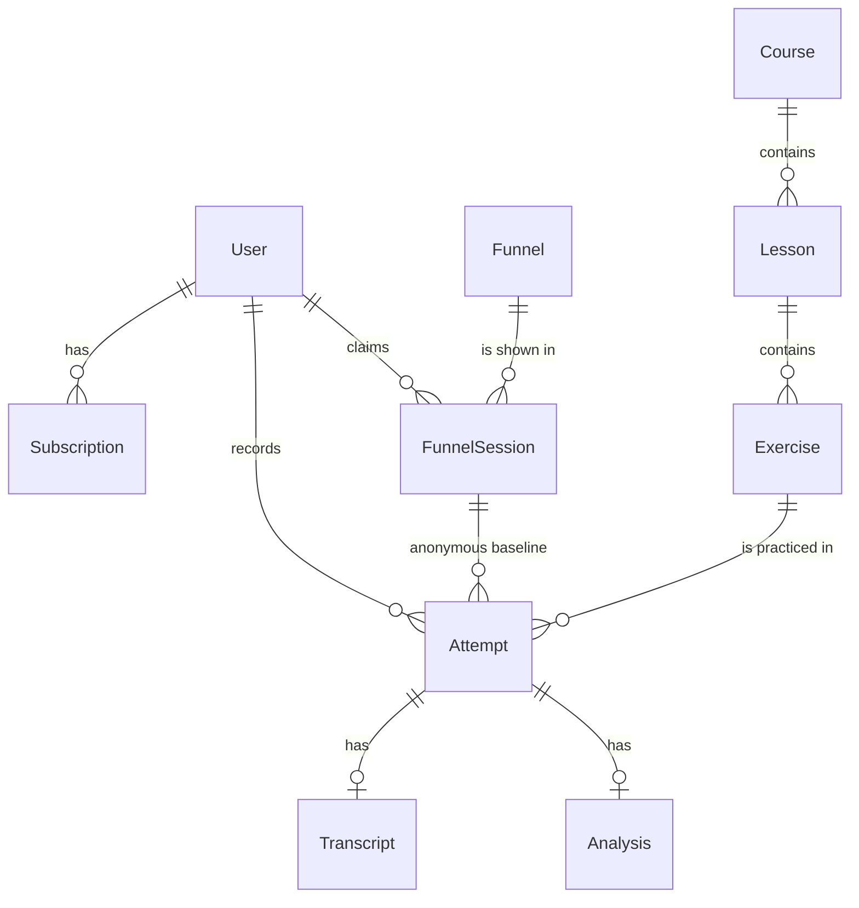

# Architecture

How SpeakUp is put together and how a request travels through it. For _why_ each piece was
chosen, see [`adr/`](./adr/README.md) and `SPEC.md` §14. For operating it, see [`runbook.md`](./runbook.md).

## System overview

| Part   | Code                                    | Job                                                                                                       |
| ------ | --------------------------------------- | --------------------------------------------------------------------------------------------------------- |
| Web    | [`apps/web`](../apps/web)               | Pages, the funnel, the recorder; talks only to the API (and to Clerk/Paddle/S3 directly from the browser) |
| API    | [`apps/api`](../apps/api)               | Auth, access rules, quotas, attempts, billing, webhooks. Stateless; scales 1–4 tasks                      |
| Worker | [`apps/worker`](../apps/worker)         | Slow work: speech-to-text, audio analysis, LLM feedback; daily cleanup. Scales 1–25 tasks on queue depth  |
| Shared | [`packages/shared`](../packages/shared) | Zod schemas and constants used by web, API and worker (API contracts, queue payloads, analysis shapes)    |
| DB     | [`packages/db`](../packages/db)         | Prisma schema, migrations, seed, typed client                                                             |
| Infra  | [`infra/cdk`](../infra/cdk)             | AWS resources as code (one stack)                                                                         |

The repo is a pnpm + Turborepo monorepo: a change to a shared schema is seen by all three apps at
once, and `turbo` builds `shared` before anything that imports it.

## Tech stack

| Concern        | Choice                                                     | Notes                                                                 |
| -------------- | ---------------------------------------------------------- | --------------------------------------------------------------------- |
| Monorepo       | pnpm workspaces + Turborepo                                | Turborepo orders and caches build/test/lint across packages; dev only |
| Web            | Next.js (App Router), TypeScript, Tailwind v4              | TanStack Query for server state, Zustand for the funnel               |
| API            | Fastify + `fastify-type-provider-zod`                      | helmet, CORS, `@fastify/rate-limit` on Redis                          |
| Worker         | BullMQ on Redis                                            | ffmpeg in the image for audio analysis                                |
| Database       | PostgreSQL 16 + Prisma                                     | Local: Docker. Production: RDS                                        |
| Queue, limits  | Redis 7                                                    | Local: Docker. Production: ElastiCache                                |
| Auth           | Clerk                                                      | Web: `@clerk/nextjs`; API verifies tokens with `@clerk/backend`       |
| Storage        | S3: private recordings bucket, public `media/*` bucket     | Local: LocalStack or a real dev bucket                                |
| Speech-to-text | Deepgram `nova-2` (REST)                                   | Behind `SttProvider`                                                  |
| LLM            | Anthropic Claude (official SDK)                            | Model from `ANTHROPIC_MODEL`                                          |
| Payments       | Paddle Billing                                             | Behind `PaymentProvider`                                              |
| Bot check      | Cloudflare Turnstile                                       | Anonymous funnel recordings only                                      |
| Validation     | Zod (shared schemas in `packages/shared`)                  | Env, HTTP, webhooks, queue jobs, LLM output                           |
| Logging        | pino with request ids, redaction in the logger             | CloudWatch in production                                              |
| Tests          | Vitest, React Testing Library, CDK assertions, k6 for load | See [`testing.md`](./testing.md)                                      |
| CI             | GitHub Actions                                             | Format, lint, typecheck, test, image builds                           |
| Hosting        | Vercel (web); AWS ECS Fargate (API, worker), CDK           | One stack in `us-east-1`; see the runbook                             |

Why each was chosen, and when we'd switch: `SPEC.md` §14 and [`adr/`](./adr/README.md).

## Two hosts, one web project

The web app is one Next.js project on Vercel with two domains attached:

| Host                       | Serves                                                                                                   | Route group                                          |
| -------------------------- | -------------------------------------------------------------------------------------------------------- | ---------------------------------------------------- |
| `speakup.fibipals.com`     | landing, `/privacy`, `/terms`, `/refund`                                                                 | `apps/web/app/(marketing)`                           |
| `app.speakup.fibipals.com` | `/start`, `/f`, `/sign-in`, `/sign-up`, `/app`, `/results`, `/pricing`, `/install`, `/offline`, `/admin` | `apps/web/app/(product)` (`/offline`: `app/offline`) |

- `proxy.ts` asks `routeForHost` (`apps/web/lib/hosts.ts`) on every request. A product route on
  the site host gets a **308** to the app host (path and query kept, so old links such as
  `speakup.fibipals.com/start?…` keep working and ad links to `/f/<slug>?utm_…` keep their UTM
  tags); a legal page on the app host gets a 308 back.
  `/` on the app host is a **307** to `/app` (which sends signed-out visitors to sign-in).
  Static files (including `/sw.js`, `/speakup.webmanifest` and `/icons/*`) skip the proxy, so
  both hosts serve them unchanged.
- Every response on the app host carries `X-Robots-Tag: noindex`: only the marketing site is meant
  for search results.
- Links that cross hosts use `appHref()` / `siteHref()` (`apps/web/lib/links.ts`).
- The split is **off** unless both `NEXT_PUBLIC_SITE_URL` and `NEXT_PUBLIC_APP_URL` are set. Local
  dev and Vercel previews leave them empty and serve every page on one host.
- Clerk needs no satellite domain: `app.` is a subdomain of the Clerk instance's primary domain
  (`speakup.fibipals.com`, frontend API `clerk.speakup.fibipals.com`). Marketing pages show no
  session UI; sign-in lives on the app host only.
- Both origins are in `speakup:webOrigins` (`infra/cdk/cdk.json`), which feeds the API's CORS,
  Clerk's `authorizedParties` and the recordings bucket's CORS. The product only calls the API
  from the app host; the site origin stays listed so sessions open during the switch keep working.

### Installable web app (PWA)

The app host can be installed to the home screen; the marketing host cannot.

- **Manifest only on the app host.** `/speakup.webmanifest` is a route handler
  (`apps/web/app/speakup.webmanifest/route.ts`, built from `apps/web/lib/pwa/manifest.ts`), linked
  only by the `(product)` layout. It is not `app/manifest.ts`, because Next links that from every
  page, landing included. The manifest has `id: "/"`, `scope: "/"`, `start_url: "/app"`
  (`PWA_START_URL`), `display: "standalone"`, the `--page` colour as theme and background, and the
  icons in `public/icons` (generated from the Mascot). The product layout also adds the Apple
  touch icon, the `apple-mobile-web-app-*` / `mobile-web-app-capable` tags and
  `viewport-fit=cover`; marketing pages get none of these.
- **Service worker** (`apps/web/public/sw.js`, hand-written, scope `/`). It is registered by
  `<PwaSetup />` in the product layout, and only in production builds (`NODE_ENV=production`, a
  secure context, `serviceWorker` support), so `pnpm dev` never runs it. It caches only the
  offline screen: `/offline` plus the CSS and font files that page references, in the cache
  `speakup-offline-v1`.
  - Navigations always go to the network and are never stored; when the network fails, the
    worker shows the cached `/offline` page.
  - `/_next/static/*` is served from the cache only if it was precached; nothing else is written.
  - It never touches non-GET requests, cross-origin requests (the API, Clerk's frontend API,
    Paddle, Amplitude, Turnstile) or same-origin `/__clerk/*`. Nothing signed-in or from the API
    is ever cached, so nothing can go stale or leak between accounts on a shared device.
- **Updates.** The worker calls `skipWaiting()` on install and `clients.claim()` on activate, so a
  new `sw.js` takes control of the open pages as soon as it has installed, without waiting for a
  reload; activating it then deletes every other `speakup-*` cache.
  When the offline page changes (new design, new CSS), bump the cache name in `sw.js`
  (`speakup-offline-v2`, …) so installed clients precache the new version.
- `/sw.js`, `/speakup.webmanifest` and `/icons/*` skip the proxy (see above), so both hosts serve
  them; the landing just never links them. If a CSP is added later it needs
  `worker-src 'self'; manifest-src 'self'`.
- **Vercel previews.** With deployment protection on, the worker's credential-less `/offline`
  fetch gets the protection's auth response instead of the page, so the install fails on purpose
  (nothing is cached and the old worker, if any, stays). Check the service worker and the offline
  screen on production or a local `next start` instead.

## Network (AWS)

- **VPC** across 2 availability zones with public, app and data subnets and one NAT gateway.
- **Public subnets:** only the load balancer (HTTPS, certificate from ACM).
- **App subnets (private):** API and worker tasks, and the one-off migration task.
- **Data subnets (private, isolated):** Postgres and Redis; only the app security groups may connect.
- S3 is reached through a VPC gateway endpoint. Task roles may only touch `recordings/*`.
- Secrets reach containers as environment variables at task start (Secrets Manager), never in
  images, templates or git.

## Main flow: a recording becomes feedback

Design points:

- **Audio never passes through the API.** The browser uploads straight to S3 with a pre-signed
  POST whose policy fixes the key, the content type, the size range and the `pending` tag.
- **Never trust the client:** submit checks the file in S3 itself (metadata only).
- **Idempotent everywhere:** a repeated submit reports the current state; the job id equals the
  attempt id, so a job is queued at most once; the worker skips finished attempts and reuses a saved
  transcript on retry (no second speech-to-text bill).
- **Two status fields:** `status` (stored: `awaiting_upload → queued → processing → completed | failed`)
  and `stage` (derived for the UI: `processing` is reported as `transcribing` until the transcript
  exists, then `analyzing`).
- **Failures:** retryable errors (timeouts, 429/5xx) are retried by BullMQ 3× with exponential
  backoff; non-retryable ones (`NO_SPEECH`, invalid LLM output twice, 4xx) fail the attempt at once
  with an `errorCode` the UI turns into a message. Abandoned uploads expire after a day (S3 lifecycle).
- **Postgres is the record, Redis is only work in flight.** Each worker runs a stuck-attempt
  sweeper (`apps/worker/src/sweeper.ts`) at startup and every 5 minutes. It looks at attempts
  that have been `queued`/`processing` without a change for 10 minutes and asks BullMQ about their
  job: **missing** (Redis lost its data, or the API died between the status change and the
  enqueue) → add it again; **still waiting/running/backing off** → leave it to BullMQ (including
  its stalled-job recovery); **finished without a result** (BullMQ gave up on a job that stalled
  twice, so the pipeline never saved a failure) → mark the attempt `failed` / `INTERNAL`, so the
  user gets an error they can retry instead of an endless spinner. It's a timer in the worker
  process, not a BullMQ schedule, because a schedule kept in Redis would be lost in exactly the
  outage it has to repair. Many workers sweeping at once is safe: re-adding uses the attempt id as
  job id (a duplicate add is ignored) and failing is a conditional update.

## Funnel flow: anonymous recording, claimed at sign-up

The funnel (`/start/<step>` or `/f/<slug>/<step>`) lets a visitor record a baseline **before**
creating an account.
The step pages get the funnel they show from a `FunnelProvider` (`apps/web/funnel/funnel-context.tsx`):
its slug, content revision (`Funnel.version`), steps and base path. `/start` passes the bundled
default funnel `main` (`packages/shared/src/funnel-default.ts`) and never calls the API for it.
`/f/<slug>` loads the live definition once per visit in the server layout
(`app/(product)/f/[slug]/layout.tsx` → `apps/web/funnel/load-funnel.ts`: `GET /v1/funnels/:slug`,
3 s timeout, cached 60 s, validated by `FunnelResponseSchema`), so moving between steps neither
refetches it nor remounts the provider. An unknown or draft slug is a 404; any other API failure
shows `app/(product)/f/error.tsx` (a mascot and "Try again", which refetches from the server). That
boundary sits one level up because a segment's own error.tsx can't catch its layout's errors.
`main` never errors: it falls back to the bundled definition so ad traffic keeps working when the
API is down.
On mount, before any step renders, the provider points the browser store at that funnel (a
different funnel starts fresh), keeps first-touch attribution (`utm_*` and the referrer's host,
never SpeakUp's own hosts) and tags every analytics event with `funnel_id` / `funnel_version`.

- The guest token is a separate auth scheme (`Authorization: Guest …`), so it can never be mistaken
  for a Clerk session. Results are shown only after the claim, to the account owner.
- Funnel state also lives in the browser (`localStorage`), so a reload resumes the same step.
- Unclaimed sessions and their recordings are deleted after 7 days (worker, daily).

## Identity and access

- **Clerk** handles sign-up/sign-in. The web app sends the Clerk session token as a Bearer token;
  the API verifies it (only tokens minted for our own web origins are accepted).
- **Lazy provisioning:** the first authenticated request creates our `User` row (no Clerk webhook). Concurrent first requests are safe: the one whose insert loses on the unique `clerkUserId` reads the winner's row.
- **One place decides the plan:** `getEntitlements()` (`apps/api/src/services/entitlements.ts`).
  A user is Pro if any subscription is `active`/`trialing` and its period hasn't ended.
- **One rule for content:** `canAccessLesson()` — free lessons for everyone, the rest for Pro. The
  course list (to show locks) and the lesson/attempt endpoints (to enforce them) use the same function.
- **Ownership:** someone else's attempt returns the same 404 as a missing one, so ids can't be probed.

## Billing

- The browser's "payment succeeded" is never trusted: only the signed webhook changes the plan.
- **Idempotent:** `WebhookEvent(source, eventId)` is unique, so a re-delivered event is a no-op.
- **Out of order:** an event older than the subscription's `lastEventAt` is recorded but ignored.
- Paddle is the merchant of record (it handles taxes); `PaymentProvider` is an interface so another
  provider could be added.

## Data model

- `Attempt` belongs to a user **or** a funnel session — enforced by a database CHECK constraint
  (`Attempt_owner_check`) as well as in code.
- `Exercise.lessonId = null` marks the baseline exercise (used by the funnel and the dashboard).
- `Analysis` stores metrics and feedback as JSON validated by the shared Zod schemas, plus the model,
  prompt version, latency and estimated cost of each analysis.
- `Funnel` holds one web funnel per `slug` (`draft` or `live`). `definition` is JSON validated by
  `FunnelDefinitionSchema` (`packages/shared`); `Funnel.version` is the content revision, separate
  from the definition's own schema-format `version`. A `FunnelSession` optionally records the funnel
  and revision it was started on, first-touch UTM values and the referrer **host** only; its
  `variant` column is reserved for A/B tests and nothing writes it yet. All of these columns are
  nullable, so sessions from before funnels lived in the DB stay valid.
- `WebhookEvent` exists only for webhook idempotency.
- Full schema: [`packages/db/prisma/schema.prisma`](../packages/db/prisma/schema.prisma).

## Analysis pipeline (worker)

One `analyze` job runs [`apps/worker/src/pipeline.ts`](../apps/worker/src/pipeline.ts). The
product rules (thresholds, what is measured, feedback shape) are in `SPEC.md` §6.3; this is where
each step lives.

| Step                            | Code                                     | Notes                                                                                                |
| ------------------------------- | ---------------------------------------- | ---------------------------------------------------------------------------------------------------- |
| 1. Speech-to-text               | `providers/deepgram.ts` (`SttProvider`)  | `nova-2` keeps "um/uh" ([ADR 0004](./adr/0004-deepgram-nova-2.md)); transcript saved now             |
| 2. Audio features (best effort) | `audio/` (ffmpeg decode, loudness, YIN)  | Real silences and per-word pitch/loudness; on failure, metrics use the transcript only               |
| 3. Metrics                      | `metrics/` (pure functions)              | Pace, pauses, punctuation, voice, language, fillers, unclear words, reading accuracy                 |
| 4. Guard                        | `pipeline.ts`                            | Fewer than 5 real words → `NO_SPEECH`, no LLM call                                                   |
| 5. Scores                       | `scoring.ts`                             | Per-skill subscores by rules; overall = weighted mean                                                |
| 6. Feedback                     | `feedback/` (prompt, Claude call, retry) | Structured output, Zod-validated, one repair round ([ADR 0005](./adr/0005-llm-structured-output.md)) |
| 7. Save                         | `repo.ts`                                | Analysis with model, prompt version, latency, cost; attempt `completed`                              |

After each status change the worker publishes the attempt id on the Redis channel
`attempt-events` (`attempt-events.ts`); API tasks holding a long-polling request answer it at once.
Every 30 s the worker also publishes the queue depth to CloudWatch (`queue-metrics.ts`), which
drives worker autoscaling. The daily funnel cleanup runs on a separate `maintenance` queue
(`cleanup.ts`).

**Retries:** jobs get 3 tries with exponential backoff (5 s, 10 s), set by the API when it adds
the job (`apps/api/src/services/analysis-queue.ts`). A `PipelineError` says whether a failure is
retryable; permanent ones become BullMQ's `UnrecoverableError` and fail at once. A worker that dies
mid-job loses its lock, and BullMQ hands the job to another worker.

## Security

The full list of requirements is `SPEC.md` §9. In short: Zod validation at every boundary, a
verified Clerk token as the only source of identity, Redis-backed rate limits (per IP, per user,
per IP per day for the funnel), Turnstile before any anonymous analysis, a private encrypted
bucket with short-lived pre-signed URLs, logs redacted by the logger itself, helmet, a CORS
allowlist and a 100 KB body limit.
